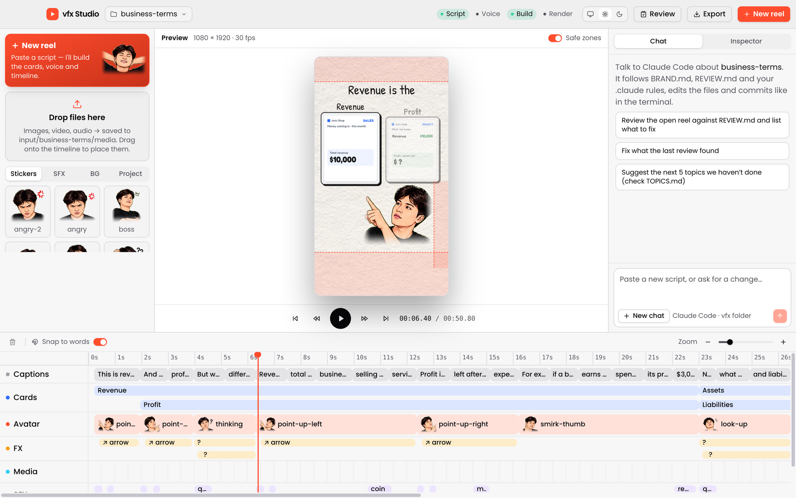

# vfx — code-based video editor

The pipeline behind **Knowledge by Joe** (@knowledgebyjoe) — *Quick comparisons. Easy explanations. Learn something
new every day.* 30–40 second reels, two quick comparisons each, written as code, voiced with ElevenLabs and rendered to MP4.
Two rendering engines + GSAP for motion + FFmpeg for the heavy lifting, plus **vfx Studio**, a Mac app to make
reels without the terminal. Everything is per project, and reels are 1080×1920 (9:16) by default.

**What a reel is:** paste a topic or a script → `script.json` (lines, cards, Joe's reaction stickers, actions, tip, CTA)
→ `build.mjs` syncs every caption and animation to the ElevenLabs word timings → HyperFrames renders →
`<project>-final_edit.mp4` (or `-final-edit.mp4`), full HD at ~5.5 MB, reviewed against `REVIEW.md` before posting.
Brand rules (fonts, colors, layout, sound, CTA) live in `BRAND.md`; every topic is logged in `TOPICS.md`.

### The format — two comparisons per reel
Any topic, general knowledge (Celsius vs Fahrenheit, kilometers vs miles, weather vs climate…). Per comparison:
**"This is X." → "This is Y."** (cards pop in) → **"What's the difference?"** → **one line about each** → **a real example
with numbers** (the facts pop on the cards as they're said). Then **one line in Joe's own voice** (a take or a memory
trick, shown as a "Joe's tip" tile) and a **follow or like CTA** (never the same type twice in a row).

**Originality check** (`node scripts/originality.mjs <reel>`): YouTube's four examples of unmonetizable content —
repetitive with minimal variation, the same storyline template, slideshow-like with little educational value,
mass-produced AI without the creator's own perspective — are checked against every earlier reel before each export
(a ✗ stops it; the review report and the app's new-reel checklist show the result).

To stay monetizable (YouTube's July 2026 "repetitive / template-based" rule) the spine stays fixed but every reel changes
the hook, card colours, stickers, background, SFX style, Joe's line and the CTA — and never
repeats a topic or pair from `TOPICS.md`. Education only, never advice. Details: `BRAND.md` §1–2, `CLAUDE.md` (YPP).

**Voice:** ElevenLabs **Liam** at 1.08×, expressive settings (a default voice — works on the free plan), then the **voice enhancer**
(`scripts/voice-fx.mjs`, preset `warm`: natural warmth and clarity, light compression that keeps the emotion, same
timing) so the channel has its own sound; tone and emotion come from expressive voice settings and scripts written
with feeling. Compare presets on any reel: `node scripts/voice-fx.mjs <reel> --samples`. Library voices (e.g. Brian S) and
commercial rights need a paid plan. **SFX:** library sounds only (CC0 uisfx + earshot renders), no Content ID risk.

```
vfx/
├── setup.sh                     # one-time install (FFmpeg, Node 22, both engines, render browsers)
├── .env                         # ElevenLabs API key + default voice
├── input/
│   ├── general/                 # shared default resources for EVERY project
│   │   ├── music/  sfx/  fonts/  logos/  overlays/  voice/
│   │   └── my different reactions/ …   (add any folders you like)
│   └── <project>/               # that project's footage, music, images
├── output/
│   └── <project>/               # ONE video: <project>-final_edit.mp4 or -final-edit.mp4 (+ review/)
├── hyperframes/
│   ├── _template/               # starter for new reels: build.mjs (cards from script.json), make.sh,
│   │                            #   script.json (voice, timing, library-only sound mix)
│   └── <project>/index.html     # the HyperFrames edit
│         assets/  → input/<project>     general/ → input/general
├── app/                         # vfx Studio — the Mac app (Electron + React + TypeScript)
├── remotion/
│   └── src/projects/<project>/  # the Remotion edit (index.tsx + Reel.tsx), auto-registered
└── scripts/                     # project commands + FFmpeg helpers
```

You never copy footage into the engine folders. Each project reads straight from `input/<project>/` and `input/general/` through links.

## vfx Studio (Mac app)

A CapCut-style editor on top of this pipeline — no Terminal needed:

- **+ New reel → paste a topic or a script** in the chat: it picks the two comparisons (skipping anything already in
  `TOPICS.md`), writes the reel, names it, builds the cards and makes the ElevenLabs voice. Ask for revisions in the
  same chat. A reel without a voice gets one as soon as you open it.
- **Media bin** (stickers, 1,194 SFX, backgrounds, your files), **frame-accurate preview** with voice + SFX in sync
  (full screen, Esc to exit), **timeline** you can drag clips on (snaps to words).
- **Voice** picker in the title bar: **Warm** (default), **Clear** or **Raw** — switches the voice sound for every reel
  and re-processes the open reel instantly (no ElevenLabs credits).
- **Usage bars** above the timeline, beside Zoom: what's left of your **ElevenLabs** credits and your **Claude** plan, as an icon + bar
  each (green → amber → red); hover for the numbers and reset time, click to check again.
- **Export** at **30 or 60 fps** with a **progress bar** (Preparing → Rendering frames → Encoding → Balancing loudness;
  the log sits behind "Show details") → small full-HD MP4, encoded once → automatic review (loudness, dead air, every frame).
- **macOS notifications**: "Reel ready to watch" when a new reel's voice and preview are done, "Export finished" when
  the video is exported (click it to see the file in Finder) — so you can switch away while it works.
- Light / dark / follow macOS; the app icon follows Tahoe's Icon & widget style. In `npm run dev` it's named
  **vfx Studio** in the menu bar, Dock and ⌘-Tab (not "Electron").

<picture>
  <source media="(prefers-color-scheme: dark)" srcset="docs/screenshots/editor-dark.png">
  
</picture>

Run it: `cd app && npm install && npm run dev` · build the dmgs: `npm run dist:mac`. Details in [`app/README.md`](app/README.md).

## Setup (once)

```bash
cd ~/Desktop/vfx
./setup.sh              # add --skills to also install the HyperFrames skills for Claude Code
```

## Workflow

```bash
./scripts/new-project.sh "Rancho at Mula de Victoria"   # → rancho-at-mula-de-victoria (both engines)
./scripts/new-project.sh halloween hf                    # HyperFrames only   (or: remotion) — copies the reel builder

# drop footage into input/<project>/, shared stuff into input/general/

./scripts/preview.sh halloween            # live preview (HyperFrames studio)
./scripts/preview.sh halloween remotion   # Remotion Studio
./scripts/check.sh halloween              # lint a HyperFrames project
./scripts/render.sh halloween             # → output/halloween/halloween-final_edit.mp4 (or -final-edit), full HD, small
                                          #   prints "progress: 45% Rendering frames" lines; full log in $TMPDIR
./scripts/render.sh halloween remotion
FPS=60 ./scripts/render.sh halloween      # 60 fps (default 30) · CRF=20 for a bigger, closer file · VERBOSE=1 full log
./scripts/render.sh halloween hf -q delivery    # extra args go to the engine
./scripts/review.sh halloween             # REPORT.md + contact sheet before posting

# explainer reels: hyperframes/<reel>/make.sh  → voice (if the words changed) + build + render
```

Referencing files in an edit:

| | This project's footage | Shared resources |
|---|---|---|
| HyperFrames (`index.html`) | `src="assets/clip.mp4"` | `src="general/music/track.mp3"` |
| Remotion (`index.tsx` / `Reel.tsx`) | `clip: "clip.mp4"` → `staticFile("<project>/clip.mp4")` | `staticFile("general/logos/logo.png")` |

HyperFrames gotcha: every `<video>`, `<audio>` and `` needs a unique `id`, otherwise it's silent or skipped in the render. Run `./scripts/check.sh <project>` to catch it.

## Voiceover (ElevenLabs)

Paste your API key into `.env` (`ELEVENLABS_API_KEY=…`) once. Optionally set a default `ELEVENLABS_VOICE_ID` and model there too. `.env` is git-ignored.

```bash
./scripts/voice.sh voices                                   # list your voices + ids → put one in .env
./scripts/voice.sh halloween "Working from home was scary enough…"   # → input/halloween/voice/<name>.mp3
./scripts/voice.sh halloween -f script.txt --name intro     # text from a file
./scripts/voice.sh general "Follow for more" --name outro-cta   # shared → input/general/voice/
./scripts/voice.sh halloween "[whispers] don't turn around" --model eleven_v3 --speed 1.1
```

Every clip also gets a `<name>.words.json` with per-word start/end times, ready for synced captions. The script prints the `<audio>` / `<Audio>` line to paste into your edit.

## FFmpeg helpers (no browser, fastest)

```bash
./scripts/probe.sh input/halloween/a.mov                       # resolution, fps, duration
./scripts/to-reel.sh input/halloween/a.mov input/halloween/a-9x16.mp4   # crop any clip to 1080x1920
./scripts/trim.sh in.mp4 00:00:03.5 00:00:09 out.mp4
./scripts/concat.sh out.mp4 a.mp4 b.mov c.mp4
./scripts/add-music.sh video.mp4 input/general/music/song.mp3 out.mp4   # MUSIC_VOL=0.6 KEEP_ORIG=0
./scripts/extract-audio.sh in.mp4 out.wav
./scripts/compress.sh in.mp4 small.mp4
```

## Why each piece is here

| Tool | Role | Why you need it |
|---|---|---|
| **FFmpeg** | The engine underneath | Every MP4 that comes out of HyperFrames or Remotion is encoded by FFmpeg. On its own it's also the fastest way to do edits that don't need a browser: trimming, cropping landscape → 9:16, joining clips, laying music under a video, compressing for upload. |
| **GSAP** | Motion / animation | Easing, staggers, timelines, text reveals, Ken Burns zooms. The timeline is always `paused` and the renderer seeks it to each frame's time, so animation is frame-perfect and repeatable. |
| **HyperFrames** | Renderer #1: HTML → video | A composition is an HTML page with `data-start` / `data-duration` on elements: plain HTML/CSS + GSAP, no build step. Ships video tooling (beat detection, captions, snapshots, lint/check, block catalog) and is built for AI agents to edit. Best for: fast reels, motion graphics, anything Claude writes for you. |
| **Remotion** | Renderer #2: React → video | Each video is a React component; the frame number is state. Strong for data-driven / templated videos (same template, many names/clips via props), TypeScript and components, or server rendering later. GSAP works inside it too. |

**Rule of thumb:** footage-only edits → `scripts/`. One-off reels and motion graphics → HyperFrames. Templated / data-driven / batch videos → Remotion.

> Licensing: Remotion is free for individuals and companies up to 3 people; bigger companies need a paid license. HyperFrames is Apache-2.0. GSAP is free (including commercial use).

`sample` is a demo project (test clip in `input/sample/`, one render per engine in `output/sample/`).
